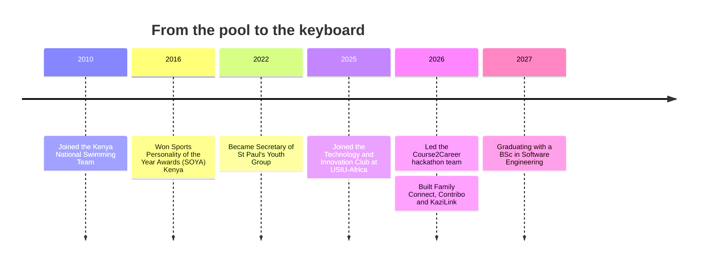

<!-- ===================== HEADER ===================== -->

 

---

## 👩🏽‍💻 About Me

I'm a final-year **BSc Software Engineering** student at **USIU-Africa** (graduating **September 2027**). I like building user-friendly apps, working in teams, and turning messy real-world problems into clean software. I'm passionate about useful tech built for Kenya and Africa.

- 🔭 Currently building: **Big Data Simulator for Refugee Flow Forecasting** (ML model with **88.7% R²**)
- 🌱 Currently deepening: Machine Learning, Cloud Computing, and full-stack systems
- 🤝 Ask me about: **React, Next.js, FastAPI, Node.js, Flask, PostgreSQL, Agile/Scrum**
- 🏆 Led a hackathon team to build **Course2Career**, an AI platform that links coursework to jobs
- ⚡ Fun fact: I've been on the **Kenya National Swimming Team** since 2010 🏊‍♀️

---

## 🛠️ Tech Stack

**Languages**

**Frameworks & Libraries**

**Databases & Cloud**

**Tools & Workflow**

---

## 🚀 Featured Projects

> 👇 Click each project to expand it.

<b>🌍 Big Data Simulator for Refugee Flow Forecasting</b> &nbsp;|&nbsp; <i>Sep 2026 – Present</i>

 

- Developing ML models to **forecast refugee movements across East Africa**, achieving **88.7% R²**
- Integrating **UNHCR, ACLED, World Bank and climate datasets** to analyse displacement trends
- Building interactive dashboards to support **data-driven humanitarian planning**

<b>🛠️ KaziLink: AI-Powered Service Marketplace</b> &nbsp;|&nbsp; <i>May 2026 – Aug 2026</i>

 

- Full-stack marketplace connecting customers with **local service providers across Kenya**
- Role-based authentication, provider registration with admin approval, service discovery, bookings, messaging and ratings
- Designed an **AI-powered matching and recommendation system**, with digital payments, geolocation and provider verification planned

<b>🏠 Family Connect</b> &nbsp;|&nbsp; <i>Jan 2026 – Mar 2026 &nbsp;(Backend Developer)</i>

 

- User-centred service marketplace prototype connecting customers with local providers
- Applied **Human-Computer Interaction principles** to streamline discovery, booking and provider comparison
- Used user feedback to improve usability, accessibility and navigation

<b>🎓 Course2Career: Hackathon Project</b> &nbsp;|&nbsp; <i>Mar 2026 &nbsp;(Team Lead)</i>

 

- Led the team building an **AI platform connecting university coursework to job opportunities**
- Built a **job-matching engine** with match scores and skill-gap analysis using AI-based parsing
- Designed a **gated job system** so applicants meet role requirements, improving candidate quality

<b>📊 Contribo: Academic Contribution Tracker</b> &nbsp;|&nbsp; <i>Jan 2026 – Mar 2026</i>

 

- Full-stack web app to **track and verify student contributions** in group projects
- Task tracking, **peer verification** and **automated PDF reports**, making grading more transparent for instructors
- Applied **SOLID principles** and secure authentication for scalability and reliability

---

## 🧭 My Journey

---

## 🤝 Leadership & Community

| | |
|---|---|
| 🏆 **Hackathon Team Lead**, USIU | Led a full-stack AI project from idea to demo |
| 💻 **Technology & Innovation Club** (Member) | Hackathons and full-stack builds since Sep 2025 |
| 🙏 **St Paul's Youth Group** (Secretary) | Organised programs for **200+ members**, including outreach to underprivileged communities in Nairobi |
| 🧒🏽 **Volunteer**, Thomas Barnardo's Children's Home | Youth mentorship and community outreach |
| 🏊‍♀️ **Kenya National Swimming Team** | National awards and international competitions |

## 🐍 My Contribution Snake

<picture>
  <source media="(prefers-color-scheme: dark)" srcset="https://raw.githubusercontent.com/Hadassah-mumbi/Hadassah-mumbi/output/github-snake-dark.svg" />
  <source media="(prefers-color-scheme: light)" srcset="https://raw.githubusercontent.com/Hadassah-mumbi/Hadassah-mumbi/output/github-snake.svg" />
  
</picture>

---

## 📬 Let's Connect

I'm looking for **software engineering internships and graduate opportunities**. If you're building something cool, let's talk!

